<div align="center">

# 🧍 坐直点 Sit Up Straight

**用电脑摄像头检测驼背，自动提醒你坐直。打开网页就能用，免费、开源、不上传任何画面。**

[](LICENSE)
[](https://github.com/yanghuiying1002/sit-up-straight/stargazers)

### 👉 [在线使用](https://yanghuiying1002.github.io/sit-up-straight/) 👈

[中文](#中文) · [English](#english)



<sub>示意动画 · 真实效果请打开 <a href="https://yanghuiying1002.github.io/sit-up-straight/">在线版</a> 体验</sub>

</div>

---

## 中文

### 为什么做这个

每天对着电脑七八个小时，不知不觉就驼背、低头、脖子往前探。等到肩颈酸痛才发现，已经晚了。

**坐直点** 会通过摄像头盯着你的坐姿，一旦驼背超过一定时间，就用声音、红框和系统通知提醒你。

### 功能

- 🎯 **实时坐姿打分**：0–100 分，并告诉你哪里有问题（头下沉、低头、太靠近屏幕、肩膀歪）
- 🔔 **三种提醒方式**：提示音、屏幕红框、系统通知，可以单独开关
- 📊 **今日统计**：坐得好的时长、驼背时长、提醒次数、良好占比
- ⚙️ **可以调节**：灵敏度、驼背分数线、多久才提醒、两次提醒的间隔
- 🪟 **画中画小窗**：切到别的窗口也能看到自己
- 🔒 **隐私优先**：所有计算都在你的浏览器里完成，画面**不上传、不保存**

### 怎么用

1. 打开 [在线版](https://yanghuiying1002.github.io/sit-up-straight/)（推荐用 Chrome）
2. 点 **开启摄像头**，允许摄像头权限
3. **坐直**、看着屏幕，点 **校准**，保持 3 秒
4. 开始工作。驼背超过 10 秒（可以调）就会提醒你

> 💡 摄像头最好放在屏幕正上方，光线充足，头和双肩都要在画面里。

### 本地运行

```bash
git clone https://github.com/yanghuiying1002/sit-up-straight.git
cd sit-up-straight
python3 -m http.server 8765
```

然后用浏览器打开 <http://localhost:8765>。

（摄像头只能在 `localhost` 或 https 地址下使用，所以不能直接双击打开 `index.html`。）

### 原理

1. 用 Google 的 [MediaPipe Pose Landmarker](https://developers.google.com/edge/mediapipe/solutions/vision/pose_landmarker) 从画面里找出眼睛、耳朵、鼻子、肩膀的位置
2. 算出 5 个指标，都按肩宽做归一化，这样人坐得远一点近一点都不影响：

   | 指标 | 驼背时的变化 |
   |---|---|
   | 眼睛到肩线的高度 | 变小（头往下沉） |
   | 肩宽占画面的比例 | 变大（凑近屏幕） |
   | 头宽 ÷ 肩宽 | 变大（头往前探） |
   | 鼻子比耳朵低多少 | 变大（低头） |
   | 肩线角度 | 偏离（肩膀歪） |

3. 跟你**校准时的坐姿**对比，偏离越多扣分越多，分数平滑后判断是否驼背

全部代码都在一个文件 [`index.html`](index.html) 里，没有构建步骤，欢迎直接阅读和修改。

### 常见问题

**画面会上传吗？** 不会。模型下载到你的浏览器里运行，画面只在本机处理。可以断网后验证：模型加载完成后断网，照样能用。

**为什么切到别的标签页后提醒变慢了？** 浏览器会给后台标签页降速。可以把页面单独放在一个窗口里，或者打开「画中画小窗」。

**支持手机吗？** 目前是给电脑设计的，手机上能打开，但体验一般。

### 路线图

- [ ] 坐姿趋势图（按周、按月）
- [ ] 久坐提醒（每隔一段时间提醒起来活动）
- [ ] 英文界面
- [ ] 桌面版（开机自启、后台运行）
- [ ] 浏览器插件版

有想法？欢迎 [提 Issue](https://github.com/yanghuiying1002/sit-up-straight/issues)。

### 参与贡献

欢迎提 Issue 和 Pull Request！特别欢迎这些反馈：
- 哪些动作**没被识别**出来，或者正常动作**被误判**成驼背
- 你的设备、浏览器，以及「调试数据」里的数字

### ☕ 支持作者

这个项目完全免费。如果它帮到了你，可以：

- ⭐ 给项目点个 **Star**，这是对我最大的鼓励
- 📢 分享给同样整天坐在电脑前的朋友
- ☕ 请我喝杯咖啡：

<!-- TODO: 把你的收款码图片放到 assets/donate/ 文件夹，文件名分别是 wechat.png 和 alipay.png -->
| 微信 | 支付宝 |
|:---:|:---:|
|  |  |

### 免责声明

本工具只是坐姿**提醒**，不是医疗器械，不能诊断或治疗任何疾病。如果长期颈肩、腰背疼痛，请咨询医生。

### 致谢

- [MediaPipe](https://github.com/google-ai-edge/mediapipe)（Apache-2.0）：姿态识别模型
- 本项目在 AI 编程助手 Claude Code 的辅助下开发

---

## English

**Sit Up Straight** watches your posture through your webcam and reminds you to sit up when you slouch. It runs entirely in your browser: free, open source, and no video ever leaves your computer.

### 👉 [Try it online](https://yanghuiying1002.github.io/sit-up-straight/)

**Features**
- Real-time posture score (0–100) with hints: head sinking, looking down, too close to the screen, uneven shoulders
- Alerts by sound, red screen border, and system notification
- Daily stats: good vs. slouching time, number of alerts
- Adjustable sensitivity, threshold, delay, and cooldown
- Picture-in-picture mode
- 100% local: powered by [MediaPipe Pose Landmarker](https://developers.google.com/edge/mediapipe/solutions/vision/pose_landmarker), video is never uploaded or stored

**How to use:** open the page in Chrome → click **开启摄像头** (Start camera) → sit up straight and click **校准** (Calibrate) → get back to work.

**Run locally:** `python3 -m http.server 8765` in the project folder, then open <http://localhost:8765>.

The UI is currently in Chinese. An English version is on the roadmap, and PRs are welcome!

**Disclaimer:** this is a posture reminder, not a medical device.

## License

[MIT](LICENSE)
